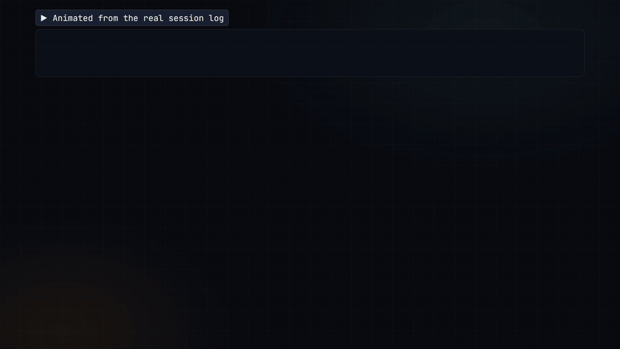

# Tasklend

**Let your coding agent delegate the grunt work to open models, and check the results.**

[](https://github.com/ElMoorish/tasklend/actions/workflows/tests.yml)


> **Pre-alpha.** Tasklend is an independent open-source project. It works with
> Claude Code but is not affiliated with, endorsed by or sponsored by Anthropic
> or NVIDIA.



*The dispatch scene is animated from a real session log. Full 52-second video:
[tasklend-launch-1080p.mp4](bench/media/final/tasklend-launch-1080p.mp4).*

Claude Code stays in charge, under your own Anthropic login. When a task is
self-contained, such as reading a codebase, drafting a plan or writing
boilerplate, Claude hands it to a worker running on an open model (NVIDIA
Nemotron by default). The worker sends back a short report, and Claude checks
its claims before using them.

> **NVIDIA's free API tier is for trials, not production or company code.**
> It may use your prompts and outputs to train models. Read
> [the free tier notice](#before-you-start-the-nvidia-free-tier) before you
> start.

## Quickstart

```
uv sync --locked
uv run tasklend init
uv run tasklend launch
```

In the Claude Desktop app, run `uv run tasklend install-skill` once instead.
You need an `NVIDIA_NIM_API_KEY` in your environment. Details are under
[Install](#install).

## Why use it

- **Keep the main context clean.** Workers read the files; Claude gets a capped
  summary instead of the raw source.
- **Spend less of your main model's usage** on reading and boilerplate.
- **Claude verifies.** In the demo run, the worker reported a bug that turned
  out to be a false alarm, and Claude caught it by checking the code.
- **Careful by design.** Your Anthropic login never passes through Tasklend, the
  proxy listens only on `127.0.0.1`, and LiteLLM is pinned to an exact version.

### One measured example

One task (explain how this repo starts its proxy and runs preflight, list the
files, name one bug), Claude Sonnet 5.5, two runs each, on this repo of about
1,400 lines:

| Average of 2 runs | Plain Claude Code | With Tasklend | Change |
| --- | --- | --- | --- |
| Main-session tokens | 261k | 177k | 32% fewer |
| List cost (USD) | 0.231 | 0.198 | 15% less |
| Final context | 63.2k | 58.6k | 7% smaller |
| Wall time | 30 s | 167 s | **5.6x slower** |

All four answers found the right files and named a real bug. This is one task,
not a general promise: the saving should grow with the amount of code a task
reads, but that is not measured yet, and the free NVIDIA worker is much slower.
Method, raw numbers and scripts: [bench/RESULTS.md](bench/RESULTS.md). The
benchmark ran before the rename, so it still says AgentRoute.

## How it works

1. `tasklend launch` starts a LiteLLM proxy on `127.0.0.1`, then starts your
   own `claude`, unmodified. The main session talks straight to Anthropic with
   your own login; Tasklend does not proxy, read or store it.
2. Claude is told it can hand self-contained tasks to workers by running
   `tasklend work --role explore|plan|code|research "<task>"`.
3. Each worker is a separate headless Claude Code run (`claude --bare -p`) whose
   model calls go to the local proxy and on to NVIDIA NIM. In `--bare` mode
   Claude Code never reads OAuth tokens or the keychain, and the worker's only
   credential is the proxy's per-session key. Workers get a private config
   folder, so they never see your Claude login or settings.
4. Worker output is capped before it returns to Claude (full output is saved
   to a file), which keeps the main session's context small.

Workers have only the tools their role needs: explore, plan and research are
read-only; code can also edit files. No worker can run shell commands.

## Before you start: the NVIDIA free tier

NVIDIA's hosted API (`integrate.api.nvidia.com` with an `nvapi-` key) is a
trial service. It is for non-production testing and evaluation only, and NVIDIA
may use your prompts and outputs to train models. Do not send confidential code,
client IP, personal data, or HIPAA or PCI data. Tasklend asks you to type
`I understand` before first use, and asks again only if this notice changes. The
same notice applies to OpenRouter `:free` models, which are off by default.

Sessions routed through Tasklend fall outside any business associate
agreement (BAA) you may have with Anthropic. Self-hosted NIM through the NVIDIA
Developer Program is also for prototyping, research, development and testing
only; production use needs an NVIDIA AI Enterprise licence.

## Install

Planned: installation with [uv](https://docs.astral.sh/uv/). Until a release
exists, run from a checkout:

```
uv sync --locked
uv run tasklend init
uv run tasklend doctor
uv run tasklend launch
```

Arguments after `--` go to `claude` unchanged, for example
`uv run tasklend launch -- --continue`.

### From the Claude Desktop app

The Desktop app starts Claude Code itself, so `tasklend launch` isn't used
there. Instead, run this once in a terminal:

```
uv run tasklend install-skill
```

It adds a `tasklend` skill to your Claude Code skills folder, so every
session, including the Desktop app's, knows how to dispatch workers. Outside
`launch`, each worker starts its own private proxy and stops it when done,
which adds about 15 seconds per worker. Remove the skill with
`uv run tasklend install-skill --remove`.

`NVIDIA_NIM_API_KEY` must be set in your environment. Tasklend never writes
API keys to disk and never reads or stores your Anthropic credentials.

## Model profiles

| Profile | What it contains |
| --- | --- |
| `us-eu-origin` (default) | US and EU models only. No PRC-origin models in any role. |
| `permissive` | Only weights under Apache 2.0, MIT or OpenMDW. |
| `research-all` | Every catalog model, including PRC-origin ones, with a warning. |

Run `tasklend profiles` to see which model serves each role. Licence details
are in [MODEL_LICENSES.md](MODEL_LICENSES.md).

## How the proxy is run

- Bound to `127.0.0.1` only.
- A new random master key for each session, kept in memory and passed to the
  proxy through its environment.
- No database, admin UI users, SSO, JWT or enterprise licence. Tasklend
  refuses to start the proxy if any of these are configured, and the admin UI,
  login and SSO routes answer 404.
- Stopped, and its temporary files deleted, when Claude Code exits.
- LiteLLM pinned to exactly `1.106.3`, installed from `uv.lock` with hashes.
  See [SECURITY.md](SECURITY.md).

## Known limits

- Pre-alpha: tested on one Windows PC so far.
- Workers on the NVIDIA free tier are slow (minutes, not seconds) and rate limited.
- Each worker started from the Desktop app adds about 15 seconds to start its own proxy.

## License

Licensed under the Apache License, Version 2.0. See [LICENSE](LICENSE) and
[NOTICE](NOTICE). Contributions need a DCO sign-off; see
[CONTRIBUTING.md](CONTRIBUTING.md).
